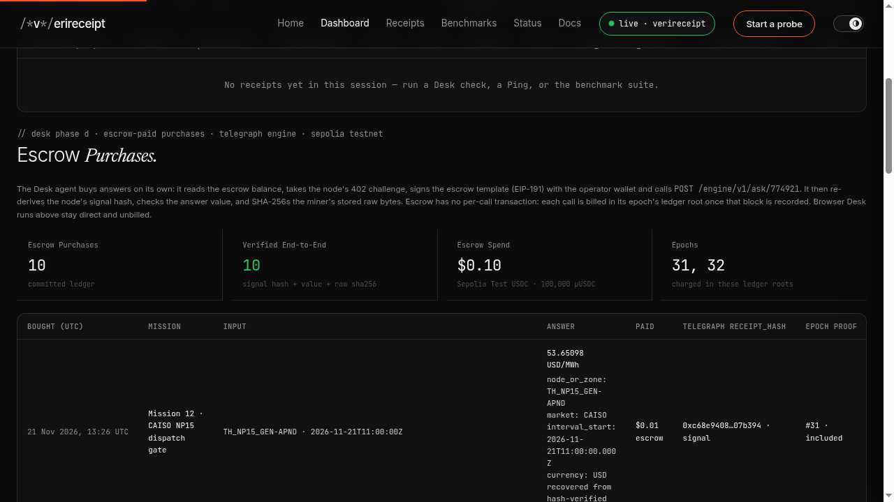
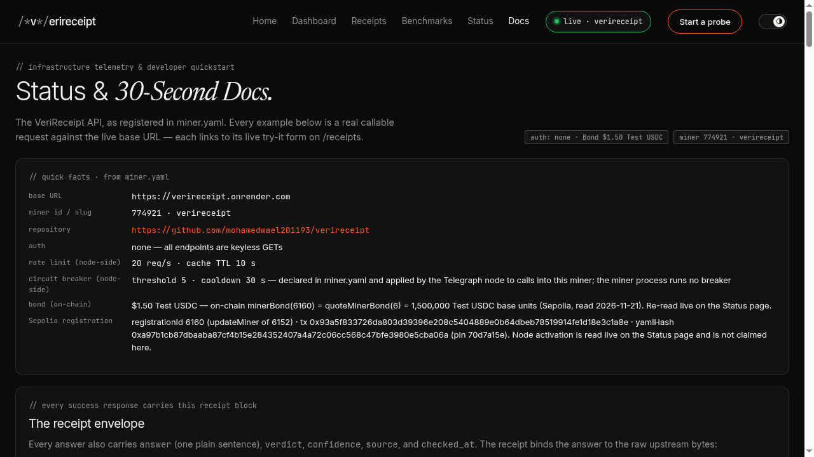

# VeriReceipt

**Sourced answers. Re-checkable bytes. Explicit limits.**

VeriReceipt is a deterministic six-intent miner and a Mission Desk app for
Telegraph Season II, Tracks 1 and 3. The miner fetches data without a language
model. Every successful answer includes the SHA-256 of its stored upstream
bytes. The Desk agent buys answers through testnet escrow and verifies the
signal, answer and stored bytes before saving a purchase.

[Live app](https://verireceipt.vercel.app/) ·
[API docs](https://verireceipt.vercel.app/docs) ·
[Health](https://verireceipt.onrender.com/health) ·
[Independent verification guide](JUDGE.md) ·
[Registration config](miner.yaml)

A matching digest proves that the stored bytes have not changed. It does not
by itself prove source truth, answer relevance or evaluator quality.

## Start with the evidence



*Production screenshot, 2026-11-21 19:09 UTC. These are operator-run,
related-party testnet purchases, not independent customers. Browser probes
are separate and unbilled. Open Dashboard, then its Receipts tab.*

| Evidence | Measured result | Reproduce or inspect |
| --- | --- | --- |
| Canonical Desk purchases | 10/10 live re-verifications passed; all 10 included in epochs 31/32 | [`purchases.jsonl`](desk/ledger/purchases.jsonl), `cd desk && npm ci && npm run verify` |
| Exact paid cost | 100,000 μUSDC, $0.10 Sepolia Test USDC | Receipt amount and epoch delivery row in each committed purchase |
| Delivery checks | Epoch, receipt hash, payer, amount, intent and miner match; root/proof shape checked | [Epoch 32 delivery example](https://devnode.telegraphprotocol.com/v1/blocks/32/deliveries/0x1184cf63601c8766196e8de0ba9514f2243fb6f9b72739ac4008b6cfa29a4f6a) |
| Desk verifier tests | 88/88 passed on 2026-11-21 | `cd desk && npm test` |
| Input coverage | Six intents; CAISO and NYISO prices, Aave TVL, a real deposit transaction, SEC filings, an ETH/USDC quote and validator 1 | Committed task inputs and hash-verified answers in the ledger |

All ten purchases occurred on **one UTC date**, 2026-11-21. Two epochs are
not two dates. These direct own-provider calls do not establish ranked-routing
credit or independent adoption. More calls are useful only when they test a
new input, failure mode or mission outcome.

### Where the project stands

- **Shipped:** six callable endpoints, stored-byte receipt inspection, browser
  Mission 12/13 workbench, testnet escrow Desk agent and public purchase ledger.
- **Being checked:** weak-pair evaluator scores and additional purposeful input
  coverage. A correct direct answer is not proof of a high network score.
- **Still to prove:** paid purchases linked to explicit mission-policy outcomes,
  a second UTC-date run and real independent use. No first-place guarantee.



*Production docs screenshot, 2026-11-21 18:39 UTC. See the live docs for current
state. Registration 6160 and YAML miner id 774921 are different identifiers.*

## The six intents

| Intent | Endpoint | What it returns |
| --- | --- | --- |
| `ONCHAIN_TX_LOOKUP_GENERAL` | `GET /v1/tx` | Transaction status, from/to, block, value — from a 2-of-N archive-RPC quorum (the API body also carries the OP-stack L1 data fee on OP-stack chains) |
| `REGULATORY_FILING_MONITOR_GENERAL` | `GET /v1/filings` | SEC EDGAR filing titles (newest first) for a company over a period, optionally of one EDGAR form type |
| `TVL_LOOKUP_GENERAL` | `GET /v1/tvl` | DeFi TVL (USD) for a protocol or chain, via DeFiLlama |
| `OPTIMAL_EXECUTION_ROUTE_GENERAL` | `GET /v1/route` | Block-pinned quote for selling exactly 1 ETH for USDC on Ethereum mainnet (best quote across Uniswap V2/V3, SushiSwap V2) |
| `GRID_POWER_PRICE_GENERAL` | `GET /v1/grid-price` | Wholesale locational marginal price (USD/MWh) from official public feeds (CAISO OASIS day-ahead, NYISO real-time, Elering 15-minute prices converted EUR→USD) |
| `VALIDATOR_PERFORMANCE_VERIFY_GENERAL` | `GET /v1/validator` | Effective balance (gwei) of an Ethereum beacon-chain validator at the finalized state, from a 2-of-4 public beacon API quorum |

Every response includes `receipt.raw_response_sha256` — the SHA-256 of the raw
upstream response the answer was derived from. See
[JUDGE.md](JUDGE.md) for the 30-second recomputation check.

A `/v1/validator` answer waits only for source replies that arrive inside the
4.5 s request budget. A response that arrives after the budget is not counted:
it cannot complete a quorum and it cannot flip a verified pair into a conflict.

## 30-second examples

```bash
BASE=https://verireceipt.onrender.com

# 1. Transaction lookup (replace the hash with a real transaction hash)
curl "$BASE/v1/tx?tx_hash=0x6ed42787fef7f854a1e8c95924a2f68b6ec113f48e141e95fe2dda1393b27005&chain=ethereum"

# 2. Filings for an entity over a period
curl "$BASE/v1/filings?entity=Apple%20Inc&period=last%2012%20months"

# 3. TVL for a protocol
curl "$BASE/v1/tvl?protocol=aave-v3"

# 4. Execution quote: sell exactly 1 ETH for USDC
curl "$BASE/v1/route?pair=ETH%2FUSDC"

# 5. Grid price for a node and interval (CAISO example)
curl "$BASE/v1/grid-price?node_or_zone=TH_NP15_GEN-APND&interval_start=2026-11-19T00%3A00%3A00Z"

# 6. Validator effective balance at the finalized Ethereum state (gwei)
curl "$BASE/v1/validator?validator_index=1"
```

### Response shape

Shape only — values are placeholders, not live data (the block number and
hash below are illustrative, not a real transaction):

```json
{
  "tx_hash": "0x6ed4…",
  "status": "success",
  "from": "0x…",
  "to": "0x…",
  "block_number": 23710000,
  "value_eth": "0.5",
  "confidence": 1.0,
  "verdict": "confirmed",
  "source": "archive-rpc-quorum",
  "receipt": {
    "raw_response_sha256": "<sha256-of-raw-upstream-response>",
    "upstream_url": "https://…",
    "fetched_at": "2026-11-20T06:00:00Z"
  }
}
```

Field names vary per endpoint; `confidence`, `verdict`, `source`, and
`receipt.raw_response_sha256` are present on every success response.

## Registration facts

- **registrationId:** `6160` on Ethereum Sepolia (chainId 11155111). Node status `active` at
  `GET https://devnode.telegraphprotocol.com/api/miners/6160` (checked 2026-11-21 17:38 UTC).
  Created by `updateMiner(6152, …)` in tx
  [`0x93a5f833726da803d39396e208c5404889e0b64dbeb78519914fe1d18e3c1a8e`](https://sepolia.etherscan.io/tx/0x93a5f833726da803d39396e208c5404889e0b64dbeb78519914fe1d18e3c1a8e)
  (block 12183278). The earlier registration 6152 is superseded and shows `deregistered` on the node.
- **Registered YAML:** [`miner.yaml` @ `70d7a15`](https://raw.githubusercontent.com/mohamedwael201193/verireceipt/70d7a15ec1fa61569e4a003fd21b8af46a97cfa9/miner.yaml),
  SHA-256 `0xa97b1cb87dbaaba87cf4b15e284352407a4a72c06cc568c47bfe3980e5cba06a`
- **Diamond (Telegraph):** `0x72a70e949362670Bf8bceAd24eFC5b8f950aa08b`
- **Floor price (on-chain):** `minPriceUsdc = 10000` = $0.01, the protocol minimum (getMiner(6160)).
  Telegraph docs (using/api-keys.md): a request costs "usually about $0.01" per miner call.
- **Bond (on-chain):** $1.50 Test USDC = `minerBond(6160)` = `quoteMinerBond(6)` = 1,500,000 base units
  ($1.00 first intent + 5 × $0.10, per `minerBondParams()`), read 2026-11-21.
- **Miner id / slug:** `774921` / `verireceipt`

## How it works

1. A request hits one of the six deterministic endpoints.
2. The server queries the official upstream source(s) directly — archive
   RPCs, SEC EDGAR, DeFiLlama, on-chain DEX pools,
   official ISO price feeds. No language model is involved anywhere.
3. The raw upstream response is hashed (SHA-256) and the hash is returned
   as `receipt.raw_response_sha256` alongside the parsed answer.
4. If an upstream is down, slow, or returns something unparseable, the
   endpoint fails closed with an error — it never invents a value.

## Limits (honest)

- **Execution routing is judgment-kind.** `OPTIMAL_EXECUTION_ROUTE` is scored
  by an evaluator whose exact criteria are not public. A block-pinned quote
  is not a promise of the network's top score or global route optimality.
- **Grid prices vary epoch to epoch.** `GRID_POWER_PRICE` scores depend on
  which ISO feeds are reachable and fresh in a given epoch; availability of
  individual feeds can change between epochs.
- **Timeline.** Season II closes Dec 1, 23:59 UTC; verification/judging Dec 2–8 (planned) — see the [rules page](https://hackathon.telegraphprotocol.com/rules).
- **Desk access.** Browser Desk checks call the miner's keyless endpoints
  directly and unbilled; no per-IP limit is enforced yet. Paid calls go
  through the Telegraph engine's escrow rail (see the Desk section below);
  escrow sponsorship of visitor checks is not shipped.

## Desk (Track 3): escrow-paid purchases

`desk/` is the VeriReceipt Desk agent (its own package; it touches no miner
file). Run once, it buys answers on its own through the Telegraph engine,
paid from the operator's escrow on the Sepolia Diamond (testnet only):

1. reads the escrow balance (`GET /v1/ledger/account/{address}`);
2. takes the node's 402 challenge for `POST /engine/v1/ask/774921` and
   refuses to sign unless it pays the Sepolia Diamond for one flat call
   (10000 μUSDC), within the Desk's daily cap and the escrow's `available`;
3. signs the escrow template with EIP-191 and resends with `X-PAYMENT`;
4. verifies the purchase end to end: the escrow receipt
   (`X-PAYMENT-RESPONSE`) matches what was signed, `keccak256` of the node's
   signal payload (`GET /engine/v1/signal/{signal_hash}`) re-derives the
   signal hash, the engine's value equals the miner's answer, and
   `sha256` of the miner's stored bytes (`/receipts/{id}/raw`) equals the
   receipt's `raw_response_sha256`;
5. appends the record to `desk/ledger/purchases.jsonl`, which the dashboard
   shows under Receipts › Escrow Purchases.

```bash
cd desk && npm ci
npm test                                             # unit tests
DESK_SECRETS_FILE=/path/to/env.txt npm run purchase  # real escrow purchases (testnet)
npm run verify                                       # re-verify the ledger from public data
npm run export                                       # copy the ledger into the frontend
```

Escrow has no per-call transaction: each call is billed once in its epoch's
ledger root. `npm run verify -- --write` records the epoch delivery proof
(`GET /v1/blocks/{epoch}/deliveries/{receipt_hash}`) once the node has
recorded that epoch's block. The official response also includes a Merkle `proof` and `deliveries_root`; we store the root and the proof length (`proof_nodes`) and shape-check the live proof (an array of 32-byte hex hashes plus the root). The leaf/node hash algorithm is not documented in the official docs, so we do not invent a proof walker. The receipt_hash ↔ signal binding comes from the paid X-PAYMENT-RESPONSE and is not re-derivable from public endpoints; a swap of receipt_hash and delivery_proof between two of our own same-intent rows, or substitution of another of our same-epoch, same-intent, same-amount deliveries (including a manual probe, `0x2a9181c9…95a1`), is not detectable. The committed `engine.result` on the three epoch-31 rows was backfilled from the captured paid replies (not fully public); ok numeric fields are re-checked against the live signal payload.

Second run (epoch 32, 2026-11-21 17:36–17:37 UTC): seven escrow-paid tasks
covering all six intents (GRID CAISO NP15 + NYISO Zone J, TVL aave-v3, TX
of the Desk's own Sepolia deposit, FILINGS Apple Form 10-Q in calendar 2025,
ROUTE ETH/USDC, VALIDATOR index 1), each VERIFIED. The ledger keeps one
purchase per task per epoch. On this run the node shaped most text fields
itself (`field_status` ok); an ok text field must equal the hash-verified raw
answer at its mapped path. FILINGS text fields were still `unavailable` and are
recovered from raw. The VALIDATOR reply reused the receipt the miner had cached
for the same finalized state root from an unpaid probe about 3 minutes
earlier (same `receipt_id`); its bytes still hash to the receipt. Epoch 32
is now recorded: all seven purchases have matching delivery rows, refreshed
2026-11-21 19:06 UTC. All ten canonical purchases pass live re-verification.
The ledger's actual receipt miner for these seven is superseded registration
6152, not 6160. New experimental calls served by 6160 are kept separately and
are not added to this ten-purchase catalog.

## Running locally

```bash
npm ci
npm run build
npm start
```

> **Node version for local tests:** run tests with Node 24 (the default
> `node`, v24.22.1). The prebuilt `better-sqlite3` binding targets Node 24;
> under Node 20 the grid tests fail at `new Database` (binding compiled for
> NODE_MODULE_VERSION 137, Node 20 needs 115). Production is unaffected:
> Render runs `npm ci` at deploy and rebuilds the binding natively for its
> own Node version. Do not run `npm rebuild better-sqlite3` locally — other
> test runs depend on the Node 24 binding.

See [`JUDGE.md`](JUDGE.md) for the independent 2-minute verification guide.
